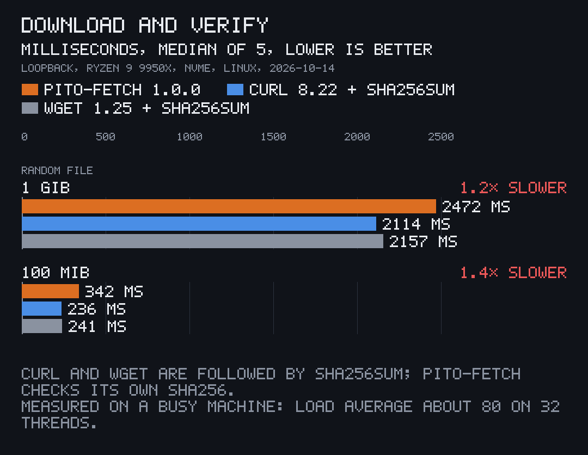
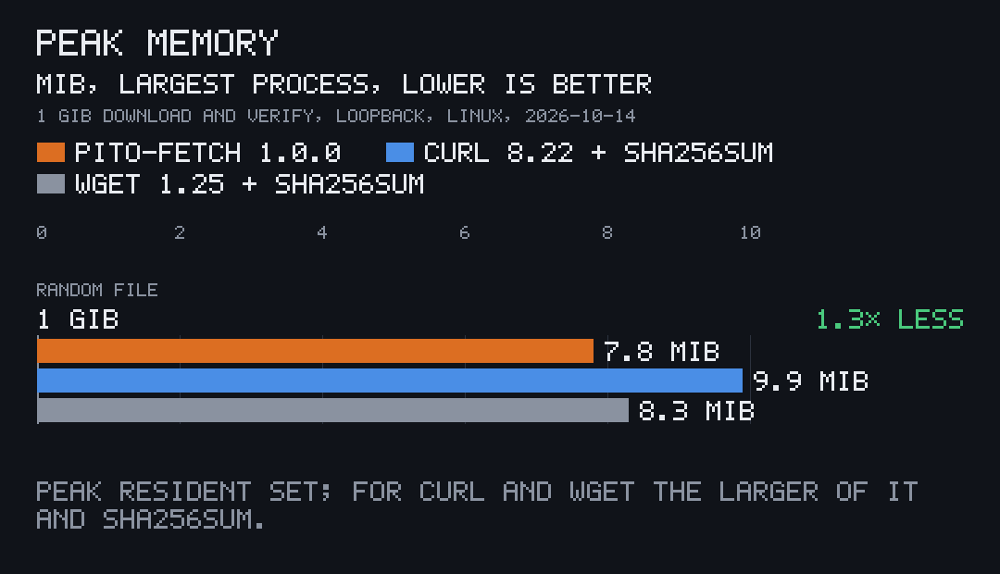

<p align="center"></p>

# pito-fetch

[](https://github.com/gmrdad82/pito-fetch/actions/workflows/ci.yml) [](https://github.com/gmrdad82/pito-fetch/tags)

**Downloads you can trust, in one call.** pito-fetch is a small Rust library, part of [PITO MD](https://pitomd.com): give it a URL, where the file goes and the file's sha256. It downloads into a `.part` file, picks that file up again after a crash or a dropped connection, checks the sha256 and only then renames it into place. A file is there whole and verified, or not at all.

| | |
|---|---|
| 1 GiB downloaded and verified | **2.47 s** on loopback, in **7.8 MiB** of memory |
| Library code | **699 lines** of Rust |
| Dependencies | **3** direct (ureq, sha2, thiserror), no OpenSSL or other system library |
| Clean release build | **11.7 s** |
| A downloader built on it | **2.5 MB** stripped, TLS and root certificates included |

How each number was measured is under [Numbers](#numbers). Works on Linux and macOS (Windows through WSL).

## Install and first use

pito-fetch isn't on crates.io. Add it from this repository, pinned to a [tag](https://github.com/gmrdad82/pito-fetch/tags); the line is the same on Linux, macOS and WSL:

```toml
[dependencies]
fetch = { git = "https://github.com/gmrdad82/pito-fetch", tag = "v1.0.1" }
```

```rust
use fetch::{CancelToken, Fetcher, Request};

let request = Request {
    url: "https://example.com/model.bin".into(),
    dest_rel: "model.bin".into(),
    sha256: "<the file's sha256, in lowercase hex>".into(),
    size_hint: None,
};
let path = Fetcher::new("models").fetch_request(&request, &CancelToken::new(), |p| {
    eprintln!("{} of {:?} bytes, {} B/s", p.received, p.total, p.speed_bps);
})?;
```

`path` is `models/model.bin`, verified. The package is named `fetch`, so the code says `use fetch::…`; it needs Rust 1.97 or newer.

To watch it work in 30 seconds, the repository's two examples serve a file locally and download it, as in the clip above:

```sh
git clone https://github.com/gmrdad82/pito-fetch && cd pito-fetch
cargo build --release --examples
mkdir -p tmp/files && head -c 50000000 /dev/urandom > tmp/files/demo.bin
target/release/examples/serve tmp/files 8471 10000000 &
sum=$(sha256sum tmp/files/demo.bin | cut -d' ' -f1)   # macOS: shasum -a 256
target/release/examples/get http://127.0.0.1:8471/demo.bin $sum tmp/models/demo.bin
```

Press Ctrl-C halfway and run the last line again: it carries on from where it stopped. `kill %1` stops the server.

## What it does

### Resumes, and lands only what matches

Bytes go to `<dest>.part`. When the download ends the whole part file is hashed, and only a sha256 match renames it to `<dest>`; a mismatch deletes the part and returns `ChecksumMismatch`. A part file left by a crash, a Ctrl-C or a cancel is picked up with a `Range` request, and a server that answers `200` or `416` to it gets a fresh download from zero. The clip at the top shows all three: a stop at 54%, a resume from 54%, and a wrong sha256 that leaves nothing behind.

### Two downloads of one file, one verified file

<p align="center"></p>

Two fetchers can ask for the same file at the same moment, from two threads or two processes. The part file is locked for every write, and a writer that finds bytes it didn't write, or its part file replaced or removed, stops writing and waits: when the other download lands, it checks that file's sha256 and returns it. If the other one goes quiet for the stall timeout, it takes over and resumes. Either way both calls end with the same verified file, and nothing mixed ever reaches the destination.

### Speed

<p align="center"></p>

Downloading a file and checking its sha256 takes pito-fetch 1.2 times as long as curl or wget followed by `sha256sum` on a 1 GiB file, and 1.4 times on 100 MiB, over loopback where the network costs nothing and the client is all that's measured. Progress comes about every 100 ms with the bytes received, the total when the server sends it, and the speed.

### Light

<p align="center"></p>

Memory stays flat whatever the file's size: bytes stream through a 64 KiB buffer to disk, and the hash reads the file back in the same 64 KiB steps. The whole library is 699 lines of Rust on three crates: [ureq](https://github.com/algesten/ureq) for HTTP and HTTPS with rustls and the Mozilla root certificates built in, sha2 and thiserror. It is blocking, one thread per download, with no async runtime.

### Safe against bad servers and bad paths

- **Contained:** the destination is a plain relative path inside the folder the `Fetcher` was made for; an absolute path or `..` is refused before anything is written, so a path from a manifest can't walk out of its folder.
- **Bounded:** a 10 s connect timeout, a stall after 30 s without a byte, three retries of I/O errors after 1, 4 and 9 s, at most 10 redirects, and a byte cap (twice the size hint, at least 1 MiB, or 8 GiB without one), so an endless body can't fill the disk. `Fetcher::with_timings` sets the timings.
- **Cancellable:** a `CancelToken` stops a download from another thread within about 200 ms and keeps the part file for a later resume. Clone it, hand the clone to another thread and call `cancel()` there.

The tests run real downloads against local servers that die mid-file, lie about the length, corrupt bytes, loop redirects or send endless bodies, with cancels, path traversal and two fetchers racing for one file.

## Use

`fetcher.fetch_request(&request, …)` takes an owned `Request`; for a list of downloads known at compile time, `FetchSpec` holds the same fields as `&'static str` and goes to `fetcher.fetch(…)`. Every failure is a `FetchError`:

| Error | When |
|---|---|
| `Offline` | the host can't be resolved or reached, or the connection failed before an answer |
| `Stalled` | no byte arrived for the stall timeout (30 s by default) |
| `Http` | the server answered with a status other than 200 or 206 |
| `ChecksumMismatch` | the downloaded file's sha256 isn't the one asked for; nothing is left behind |
| `Cancelled` | the `CancelToken` was cancelled; the part file stays for a resume |
| `Io` | a file couldn't be written, renamed or read, or the destination isn't a plain relative path |

`sha256_hex(&bytes)` and `StreamHasher` give the same lowercase hex digests, for writing the sums in the first place.

[`examples/get.rs`](examples/get.rs) is a small downloader on the library, with a progress line on a terminal: `get <URL> <SHA256> <DEST>`. [`examples/serve.rs`](examples/serve.rs) serves a folder on `127.0.0.1` with `Range` support at an optional rate in bytes per second: `serve <DIR> <PORT> [BYTES_PER_SECOND]`.

## Numbers

Measured once on 2026-10-14, on Linux with an AMD Ryzen 9 9950X (16 cores, 32 threads) and an NVMe disk, with Rust 1.97.1. The machine was busy with other work at the time (load average about 80), so every client ran slower than it would alone; all three ran under the same load, interleaved run by run.

- **Download and verify:** [`bin/bench`](bin/bench) serves a file of random bytes with the `serve` example on 127.0.0.1 and times, five times each and interleaved, the `get` example (download and sha256 check in one process) against `curl -o` (curl 8.22) and `wget -O` (wget 1.25), each followed by `sha256sum`. The chart shows the medians: 1 GiB in 2472, 2114 and 2157 ms; 100 MiB in 342, 236 and 241 ms.
- **Peak memory:** the peak resident set (`ru_maxrss`) of each process for the 1 GiB file: `get` 7.8 MiB; curl 9.9 MiB, wget 8.3 MiB and `sha256sum` 8.3 MiB, so the larger of each pair is charted.
- **Lines:** the library's `src/`, without its unit tests, blank lines or comments.
- **Dependencies:** `cargo tree`: three direct, 35 crates in all, build-time macros included. ring, under rustls, compiles a little C and assembly, so a build needs a C compiler; nothing links to a system library at run time.
- **Build:** `cargo build --release --locked` from a clean target folder.
- **Binary:** the `get` example from `cargo build --release --examples`, 3.4 MB as built and 2.5 MB after `strip`.

The charts are drawn by [pito-compare](https://github.com/gmrdad82/pito-compare) from [`docs/charts/`](docs/charts).

## Part of PITO MD

pito-fetch is one of the building blocks of [PITO MD](https://pitomd.com) apps. [pito-renew](https://github.com/gmrdad82/pito-renew) updates an app with a sha256-verified download swapped in place, and [pito-embed](https://github.com/gmrdad82/pito-embed) brings on-device text embeddings; both fetch their files through pito-fetch. The clips here are recorded by [prec](https://github.com/gmrdad82/prec) and made GIFs by [pconv](https://github.com/gmrdad82/pconv), and the charts are drawn by [pito-compare](https://github.com/gmrdad82/pito-compare).

## Contributing

Issues are welcome at [github.com/gmrdad82/pito-fetch/issues](https://github.com/gmrdad82/pito-fetch/issues): a download that went wrong, with the server's answer if you can share it, or something the library should handle. Pull requests aren't taken. Please read the [code of conduct](CODE_OF_CONDUCT.md) first, and report a security issue privately as [SECURITY.md](SECURITY.md) says.

## Build and test

```
cargo build --release
bin/gate
```

`bin/gate` runs what CI runs: ShellCheck where it is installed, rustfmt, clippy with warnings as errors, and the tests. CI runs the gate on Linux and macOS on every push and nightly, and a tag publishes its GitHub Release with the [CHANGELOG](CHANGELOG.md)'s notes and a docs bundle, `docs-vX.Y.Z.tar.gz`, that `bin/docs-bundle` builds from the guides in [`docs/pages/`](docs/pages), the API reference from `cargo doc` and the CHANGELOG. The clips are prec shots in `render/terminal.toml`, and [NOTICE](NOTICE) lists every image and where it comes from.

## Licence


The code is MIT licensed ([LICENSE](LICENSE)), © Catalin Ilinca. The pito-fetch and PITO MD names and their logos are © Catalin Ilinca, all rights reserved, and are not covered by the MIT licence ([TRADEMARKS.md](TRADEMARKS.md)).
